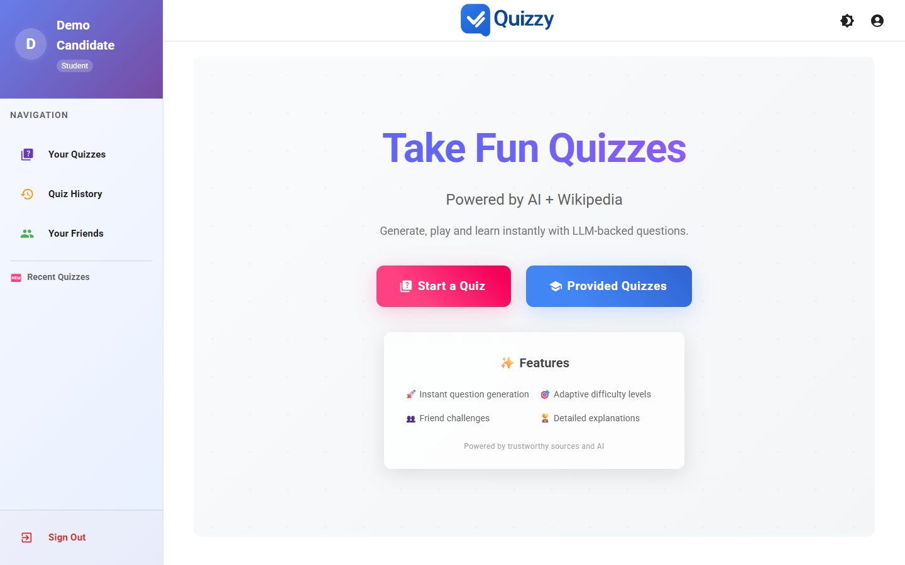
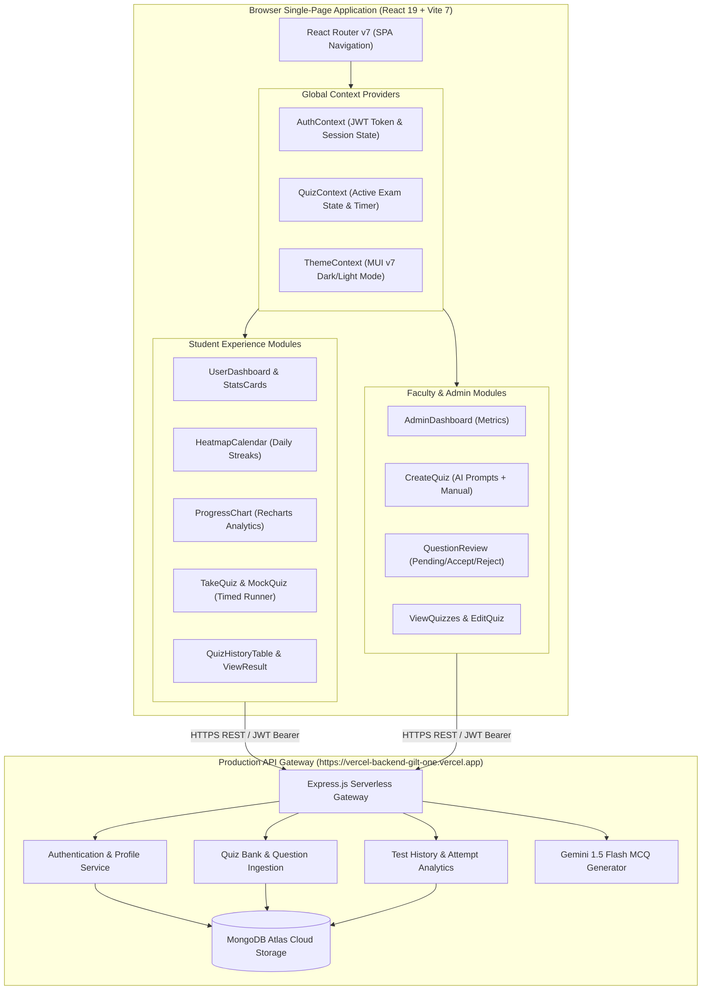
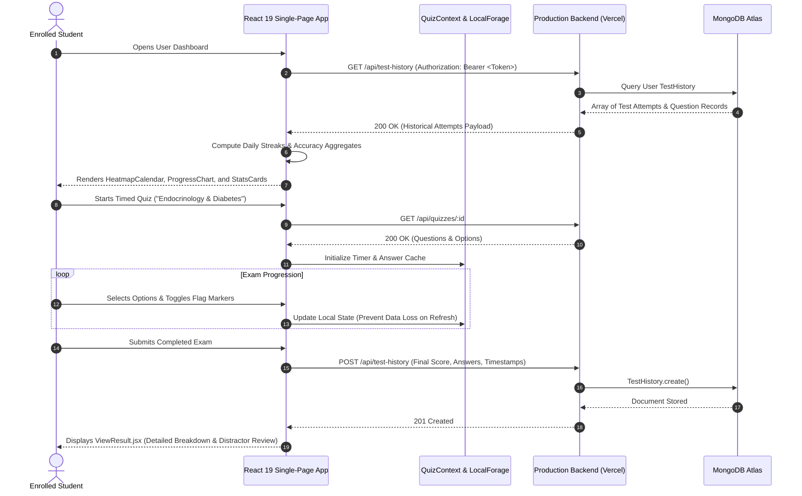

# 🎯 MCQ-Main-Frontend — Enterprise AI Examination & Analytics Portal

<div align="center">


### Production Web Client for Generative Assessments, Test Analytics & Question Curation
*An interactive React 19 single-page examination hub featuring Recharts analytics, GitHub-style study heatmaps, and educator QA workflows.*

[](https://github.com)
[](https://react.dev)
[](https://vitejs.dev)
[](https://mui.com)
[](https://recharts.org)
[](https://vercel-backend-gilt-one.vercel.app)
[](LICENSE)

</div>

---

## Application Screenshot & Interface Preview

<div align="center">
  
</div>

---

## 🌐 Suite 5 Ecosystem & Cross-Repository Links

**mcq-main-frontend** is the dedicated production web presentation layer of the **Suite 5 (Medical & AI Quiz Ecosystem)**. It interfaces with our cloud engines and mobile clients:

| Repository | Role | Core Technology | Link |
| :--- | :--- | :--- | :--- |
| **mcq-main-frontend** (This Repo) | Production Web Exam Center & Analytics Portal | React 19 / Vite / Recharts / Vercel Host | [mcq-main-frontend](file:///c:/Users/pandi/OneDrive/Desktop/github/mcq-main-frontend) |
| **quiz-Generator--main** | Primary Enterprise Backend Engine & Full-Stack Suite | React 19 / Express 5 / MongoDB / Gemini 1.5 Flash | [quiz-Generator--main](file:///c:/Users/pandi/OneDrive/Desktop/github/quiz-Generator--main) |
| **quiz-Generator-** | Foundational AI MCQ Algorithmic Core Prototype | Express / Google Generative AI / Vite Prototype | [quiz-Generator-](file:///c:/Users/pandi/OneDrive/Desktop/github/quiz-Generator-) |
| **DCP-QUIZZY** | Medical Mobile App Client & Licensing Engine | React Native / Expo 57 / Express / MongoDB | [DCP-QUIZZY](file:///c:/Users/pandi/OneDrive/Desktop/github/DCP-QUIZZY) |

> [!NOTE]
> **Production Backend Integration**: This web application communicates by default with the deployed production backend hosted at [**`https://vercel-backend-gilt-one.vercel.app`**](https://vercel-backend-gilt-one.vercel.app). For local backend development, see [**quiz-Generator--main**](file:///c:/Users/pandi/OneDrive/Desktop/github/quiz-Generator--main).

---

## 📌 Executive Summary & Educational Impact

High-stakes testing platforms frequently suffer from clunky user interfaces, lack of real-time student telemetry, and absent curriculum management tools. Students need clear visibility into their daily study habits, score progression, and weak topic clusters, while academic administrators need friction-free tools to curate question banks without writing boilerplate code.

**MCQ-Main-Frontend** solves these user experience challenges by delivering:
1. **Student Cognitive Analytics**: High-density interactive visualizations built with **Recharts**, including longitudinal score progress curves, topic mastery radars, and a **GitHub-style daily study streak heatmap** (`HeatmapCalendar.jsx`).
2. **Standardized Exam Interface**: A distraction-free timed test engine with dynamic question status indicators, unanswered question alerts, and instant review capabilities (`TakeQuiz.jsx`).
3. **Faculty QA Triage Dashboard**: Comprehensive review console (`QuestionReview.jsx`) providing educators with batch triage tools to inspect AI-generated questions, edit distractors, and transition items between `pending`, `accepted`, and `rejected` states.
4. **Resilient SPA Performance**: Engineered on React 19 and Vite 7, featuring client-side route protection, sub-second HMR development cycles, and automated rewrite rules (`vercel.json`) for worldwide CDN edge hosting.

<div align="center">
  
</div>

---

## 🚀 Key Features

- 📈 **Visual Progress Tracking**: Real-time performance dashboards powered by Recharts (`ProgressChart.jsx`) tracking student accuracy across topics and difficulty tiers.
- 📅 **GitHub-Style Study Heatmap**: Interactive activity calendar (`HeatmapCalendar.jsx`) tracking daily test volumes, study streaks, and consistency metrics.
- 🎯 **Executive KPI Stats Cards**: Glanceable metric cards (`statscard.jsx`) highlighting total tests taken, overall pass percentage, and average time per question.
- ⏱️ **Full-Featured Exam Simulation**: Timed examination runner with elapsed timers, progress gauges, and rapid question jump matrices.
- 📋 **Historical Attempt Audit**: Paginated and filterable history table (`QuizHistoryTable.jsx`) enabling students to revisit any past test attempt with complete question-by-question rationales.
- 👩‍💼 **Comprehensive Admin Suite**:
  - `AdminDashboard`: Platform-level overview of active quizzes, question counts, and user participation.
  - `CreateQuiz`: Multi-step wizard supporting AI generation prompts and manual MCQ insertion.
  - `QuestionReview`: Triage workflow for approving or refining pending AI question proposals.
  - `viewQuizzes`: Central table for editing, toggling visibility, or archiving assessments.
- 🌗 **Accessible Material-UI v7 Design**: Seamless dark/light theme switching with adaptive color contrast adhering to WCAG 2.1 accessibility standards.

---

## 🏛️ System Architecture

The following diagram maps the frontend client component hierarchy and its communication with the production Vercel cloud backend:



---

## 🔄 Data Flow & Sequence Diagram

This sequence details how a student launches a session, reviews real-time analytics, and synchronizes test results with the production backend:



---

## 🛠️ Complete Tech Stack Breakdown

| Layer | Technology | Version | Purpose / Architectural Responsibility |
| :--- | :--- | :--- | :--- |
| **UI Framework** | React | `^19.1.1` | Next-generation React concurrency, optimized state updates |
| **Bundler & Tooling** | Vite | `^7.1.2` | Lightning-fast development server and optimized production rollup builds |
| **Component Library** | Material-UI (MUI) | `^7.3.1` | Accessible design components, cards, tables, navigation, and dialogs |
| **Icons** | Material Icons | `^7.3.1` | Google Material Design icon library |
| **CSS-in-JS Engine** | Emotion React & Styled | `^11.14` | Theming engine supporting responsive style overrides and dark mode |
| **Analytics & Charts** | Recharts | `^3.1.2` | SVG-based responsive data charting for score trends and mastery curves |
| **Client Routing** | React Router DOM | `^7.8.0` | Declarative client-side routing, query param parsing, route guards |
| **HTTP Client** | Axios & Fetch API | `^1.11.0` | Secure API calls with automatic authentication header attachment |
| **Storage Engine** | LocalForage | `^1.10.0` | Asynchronous local client storage engine utilizing IndexedDB |
| **Production Target** | Vercel Edge Network | Production | Globally distributed static and serverless edge delivery |

---

## 📂 Repository Directory Structure

```text
mcq-main-frontend/
├── .env                            # Client API environment endpoint configuration
├── .env.example                    # Sanitized template for environment configuration
├── .gitignore                      # Git exclusion rules (ignores .env and local caches)
├── eslint.config.js                # ESLint 9 configuration
├── index.html                      # Single page application HTML entry
├── package.json                    # Project dependencies and npm scripts
├── vercel.json                     # SPA routing rewrite rule configuration for Vercel
├── vite.config.js                  # Vite configuration and React plugins
│
├── scripts/
│   └── add-jsx-extension.ps1       # Developer utility for component extension refactoring
│
└── src/                            # Application source code
    ├── App.css                     # Global utility classes and animations
    ├── App.jsx                     # Top-level routing layout & provider wrapper
    ├── index.css                   # CSS reset and baseline typography
    ├── main.jsx                    # Application entry mounting React 19 root
    │
    ├── assests/                    # Static image and visual assets
    │   └── images/
    │       ├── logo.png            # Primary brand logo
    │       └── logo2.png           # Secondary brand emblem
    │
    ├── components/                 # Reusable component library
    │   ├── admin/                  # Administrative and pedagogical tools
    │   │   ├── AdminDashboard.jsx  # Platform metrics and activity feed
    │   │   ├── CreateQuiz.jsx      # Manual & AI quiz authoring wizard
    │   │   ├── EditQuiz.jsx        # Quiz metadata and question modifier
    │   │   ├── QuestionForm.jsx    # Standalone question authoring form
    │   │   ├── QuestionList.jsx    # Paginated question directory
    │   │   ├── QuestionReview.jsx  # Question triage board (pending/accept/reject)
    │   │   └── viewQuizzes.jsx     # Master quiz inventory table
    │   ├── auth/                   # Authentication forms
    │   │   ├── Login.jsx           # Sign-in portal with JWT acquisition
    │   │   └── Register.jsx        # Account registration with role selection
    │   ├── common/                 # Layout and structural components
    │   │   ├── Layout.jsx          # App scaffolding with header and footer
    │   │   ├── Navbar.jsx          # Dynamic navigation bar with role toggles
    │   │   ├── Profile.jsx         # User account settings and password update
    │   │   ├── ProtectedRoute.jsx  # Route guard for authenticated users
    │   │   └── PublicRoute.jsx     # Public visitor redirect handler
    │   └── user/                   # Student examination & analytics components
    │       ├── EmptyState.jsx      # Onboarding component for new users
    │       ├── HeatmapCalendar.jsx # GitHub-style daily study streak heatmap
    │       ├── MockQuiz.jsx        # Rapid practice quiz mode
    │       ├── ProgressChart.jsx   # Recharts longitudinal performance visualizer
    │       ├── Quiz.jsx            # Active quiz taking container
    │       ├── QuizDetail.jsx      # Quiz overview and syllabus breakdown
    │       ├── QuizHistoryTable.jsx# Paginated test logs with score filters
    │       ├── Results.jsx         # Summary metrics following test completion
    │       ├── statscard.jsx       # Glanceable KPI statistical cards
    │       ├── TakeQuiz.jsx        # Timed test engine with countdown timer
    │       ├── TestHistory.jsx     # Master student history dashboard
    │       └── ViewResult.jsx      # In-depth question-by-question review
    │
    ├── contexts/                   # Context State Providers
    │   ├── AuthContext.jsx         # User identity, JWT tokens, and RBAC roles
    │   ├── QuizContext.jsx         # Active quiz status, answers, and elapsed time
    │   └── ThemeContext.jsx        # Material-UI dynamic light/dark theming
    │
    ├── hooks/                      # Custom React Hooks
    │   ├── useAuth.js              # Hook for interacting with AuthContext
    │   └── useQuiz.js              # Hook for interacting with QuizContext
    │
    ├── pages/                      # Page-level route views
    │   ├── Home.jsx                # Landing page introducing the portal
    │   ├── NotFound.jsx            # Custom 404 page
    │   ├── Unauthorized.jsx        # 403 Forbidden access page
    │   └── api/                    # Client fallback scripts
    │       └── generate-questions.js
    │
    ├── services/                   # External API connectors
    │   ├── api.js                  # Direct AI prompt request dispatcher
    │   ├── auth.js                 # Authentication service (login, register)
    │   └── quiz.js                 # Quiz operations service
    │
    └── utils/
        └── storage.js              # Encapsulated LocalStorage & LocalForage operations
```

---

## ⚡ Local Setup & Installation

### 1. Prerequisites
- **Node.js**: v20.x or higher installed (`node -v`)
- **npm** or **yarn**: npm v9+ recommended

---

### 2. Environment Configuration

Clone the repository and set up the environment variables:
```bash
git clone https://github.com/your-username/mcq-main-frontend.git
cd mcq-main-frontend

# Create local environment file from example template
cp .env.example .env
```

Configure `.env` to point to either the live production backend or your local backend:
```env
# Production Backend (Default)
VITE_API_URL=https://vercel-backend-gilt-one.vercel.app
NEXT_PUBLIC_API_URL=https://vercel-backend-gilt-one.vercel.app
REACT_APP_API_URL=https://vercel-backend-gilt-one.vercel.app

# Alternatively, for local backend development:
# VITE_API_URL=http://localhost:5000
```

---

### 3. Dependency Installation & Development Server

```bash
# Install dependencies
npm install

# Start Vite local development server
npm run dev
# Server running at: http://localhost:5173/
```

Open `http://localhost:5173` in your browser. Register an account or sign in to begin taking exams or managing test banks.

---

## 📡 API Integration & Backend Connection

The frontend seamlessly connects to the deployed Vercel backend at `https://vercel-backend-gilt-one.vercel.app`. The following endpoints are consumed across user and admin journeys:

| UI Component | Endpoint Called | Method | Description |
| :--- | :--- | :---: | :--- |
| `Login.jsx` | `/api/login` | `POST` | Authenticates credentials and stores JWT token |
| `Register.jsx` | `/api/register` | `POST` | Creates new student or educator account |
| `Profile.jsx` | `/api/auth/profile` | `GET` | Fetches current user profile and account details |
| `Profile.jsx` | `/api/auth/change-password` | `PUT` | Updates existing account password |
| `CreateQuiz.jsx` | `/api/generate-mcqs` | `POST` | Generates new questions via Gemini AI |
| `CreateQuiz.jsx` | `/api/quizzes` | `POST` | Persists new quiz to the database |
| `viewQuizzes.jsx` | `/api/quizzes/public` | `GET` | Loads all active public quizzes |
| `TakeQuiz.jsx` | `/api/quizzes/:id` | `GET` | Loads single quiz questions for active testing |
| `TakeQuiz.jsx` | `/api/test-history` | `POST` | Submits completed exam attempt and answers |
| `TestHistory.jsx` | `/api/test-history` | `GET` | Loads user test history for charts and heatmaps |
| `QuestionReview.jsx`| `/api/quizzes/:id` | `PUT` | Updates question status (`accepted`/`rejected`) |

---

## 🚢 Production Deployment (Vercel)

The repository includes a ready-to-deploy `vercel.json` configuration handling Single-Page Application (SPA) routing:

```json
{
  "rewrites": [
    {
      "source": "/(.*)",
      "destination": "/index.html"
    }
  ]
}
```

### Steps to Deploy:
1. Push your code to your GitHub / GitLab repository.
2. Log in to [Vercel](https://vercel.com) and click **"Add New Project"**.
3. Import the `mcq-main-frontend` repository.
4. Set Build Settings:
   - **Framework Preset**: Vite
   - **Build Command**: `npm run build`
   - **Output Directory**: `dist`
5. Configure Environment Variables in Vercel:
   - `VITE_API_URL` = `https://vercel-backend-gilt-one.vercel.app`
6. Click **Deploy**. Vercel will provision an edge-optimized global deployment in seconds.

---

## 🛡️ Security, Performance & Best Practices

- **SPA Fallback Routing**: With `vercel.json` rewrite rules in place, direct page reloads on deep URLs (e.g., `/user/test-history`, `/admin/review`) resolve cleanly without `404 Not Found` errors.
- **Client-Side Token Protection**: JWT tokens are retained in memory and synchronized via secure storage abstractions, preventing persistent session fixation vulnerabilities.
- **Lazy Rendering & Code Splitting**: Heavy analytics libraries like Recharts are tree-shaken and split by Vite to ensure lightning-fast initial page loads.
- **Optimistic State & Local Caching**: In-progress examination answers are buffered in `QuizContext` and `localforage` so students never lose progress during sudden network drops.
- **Accessibility & Contrast**: Built upon Material-UI v7 with dynamic high-contrast theme definitions, ensuring readable typography for long study sessions.

---

## 📄 License

This project is licensed under the **MIT License** — see the [LICENSE](LICENSE) file for full details.

---

<div align="center">
  <sub>Part of the <b>Suite 5 Medical & AI Quiz Ecosystem</b>. The premier web testing portal for AI-generated medical and general assessments.</sub>
</div>
